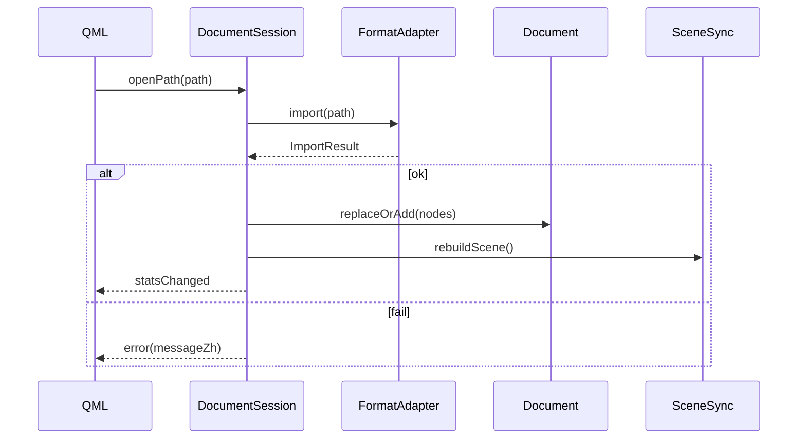
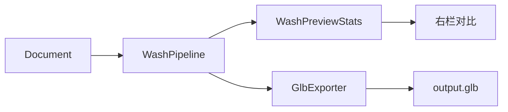

# ModelWash 概要设计书

| 项 | 内容 |
|----|------|
| 版本 | 0.1 |
| 状态 | 已与 CONSENSUS / ADR-020～026 对齐 |
| 范围 | 系统结构、模块职责、数据流、发布与部署；不含类级细节（见详细设计） |

---

## 1. 编写目的

把已拍板的产品共识落成 **可分工的软件结构**：全 C++ / Qt 6 原生应用，本地优先，按 ReleaseTrain 分期交付。

---

## 2. 系统概述

### 2.1 定位

桌面端 3D 资产清洗与轻度修整工具：导入 → 预览 → 清洗/修整/拼装/摆拍 → 导出 GLB。

### 2.2 运行环境

| 项 | 选择 |
|----|------|
| OS | Windows 10/11 x64（首发）；其它桌面后续 |
| 语言 | C++17 或 C++20（实现时钉死） |
| UI | Qt Quick (QML) |
| 3D | Qt Quick 3D |
| 构建 | CMake + vcpkg |
| Qt 许可 | 0.x：LGPL + 动态链接 |

### 2.3 逻辑架构

```text
┌─────────────────────────────────────────────┐
│                 app (QML + C++ 壳)           │
│  主窗 / 人设 / 模式面板 / 对话框 / 关于      │
├─────────────────────────────────────────────┤
│              presentation 绑定层             │
│  DocumentSession / 命令网关 / 进度信号       │
├─────────────────────────────────────────────┤
│                    core                      │
│  Document · CommandStack · Wash · TouchUp    │
│  Assemble · PresentPresets · Stats           │
├──────────────┬──────────────────────────────┤
│ io           │  render_bridge                 │
│ FormatAdapter│  SceneSync → Quick3D 节点     │
│ AssimpImport │                               │
│ GlbExporter  │                               │
└──────────────┴──────────────────────────────┘
         │                    │
    第三方库              Qt Quick 3D / RHI
  Assimp, meshoptimizer,
  Draco, ...
```

**原则**：`core` 不依赖 QML；GUI 测试可用假 session；清洗管线可做 CLI 狗粮（可选 `tools/wash_cli`）。

---

## 3. 模块职责

| 模块 | 职责 | 切片 |
|------|------|------|
| `app` | QML 页面、主题、设置、文件对话框、拖放 | 0.1+ |
| `presentation` | 把 Document 暴露给 QML（QObject/ListModel）、转发用户操作到 Command | 0.1+ |
| `core::document` | 场景对象、材质引用、选择集、脏标记、统计 | 0.1+ |
| `core::command` | 撤销/重做栈；所有破坏性编辑入栈 | 0.1 骨架，0.2+ 填满 |
| `core::wash` | 网页/游戏预设、减面、贴图限制、清理、压缩参数 | 0.1 |
| `core::touchup` | 笔刷与整体光滑 | 0.2 |
| `core::assemble` | 贴地、包围盒对齐、SurfaceSnap、bake-merge | 0.3 |
| `core::present` | 灯光/背景/BeautyPreset 数据 | 0.4（0.1 可极简默认光） |
| `io` | FormatAdapter、Assimp 导入、专用 GLB 导出 | 0.1 |
| `render_bridge` | Document → Quick3D 网格/材质同步、拾取射线入口 | 0.1+ |

---

## 4. 关键数据流

### 4.1 打开文件



### 4.2 清洗并导出



- **预览**：可在临时 Document 副本上跑管线，确认后再写盘或写回主 Document（详细设计定一种；推荐「副本预览 + 用户确认后替换」避免误伤）。
- **StaticWashOnly**：管线内检测蒙皮/形态键/动画通道，跳过几何简化并汇总警告。

### 4.3 命令与撤销

所有「改 Document」的操作：`ICommand::execute/undo`。  
视口拖拽变换：鼠标松开时提交一条 `TransformCommand`。  
笔刷：一笔或一小段采样合并为一条 `SculptStrokeCommand`（防栈爆炸）。

---

## 5. 目录结构（目标仓库）

```text
modelwash/
  CMakeLists.txt
  vcpkg.json
  CONTEXT.md
  docs/
    CONSENSUS.md
    adr/
    ui/
    design/
  src/
    app/           # main.cpp, qml.qrc, 主 QML
    presentation/  # Session, models
    core/
      document/
      command/
      wash/
      touchup/
      assemble/
      present/
    io/
    render_bridge/
  resources/       # 默认 HDRI 缩略、图标、许可证文本
  tests/           # GTest：wash、io roundtrip
  tools/           # 可选 wash_cli
```

实施第一步：删除现有 Tauri/Vite 树（ADR-026），再按上表建仓。

---

## 6. 外部依赖（概要）

| 库 | 用途 |
|----|------|
| Qt6 Quick / Quick3D | UI + 视口 |
| Assimp | 多格式导入 |
| meshoptimizer | 减面 / meshopt 压缩相关 |
| Draco | 可选几何压缩 |
| （自研或轻量）glTF 写出 | 产品级 GLB 导出 |
| GTest | 单测 |

版本钉在 `vcpkg.json` / README。

---

## 7. 非功能需求

| 类别 | 要求 |
|------|------|
| 本地优先 | 模型不上传；更新检查可关 |
| 性能 | 软阈值见 ADR-016；巨模引导先清洗 |
| 安全 | 路径遍历无；导出不覆盖前可确认 |
| 许可 | 关于页展示 Qt LGPL 与第三方许可证 |
| 国际化 | 默认中文；字符串集中，预留 Qt linguist |

---

## 8. 发布与部署

| 切片 | 交付物 |
|------|--------|
| 0.1 | 可安装或绿色版：动态 Qt DLL + 应用 EXE；清洗主路径可用 |
| 0.2–0.4 | 同安装通道增量功能 |
| 1.0 | 签名（若具备）、完整关于/帮助、卸载干净 |

打包：`windeployqt` + 自有 DLL；校验 LGPL 动态链接方式。

---

## 9. 风险（概要）

| 风险 | 缓解 |
|------|------|
| Quick3D 拾取/笔刷能力不足 | render_bridge 预留自定义扩展；必要时局部 OpenGL/RHI 通道（另开 ADR） |
| Assimp→自研导出信息丢失 | 黄金 GLB 样例回归；Document 中间表示显式 |
| 完整 Assemble+Present 工期 | 严格按 ReleaseTrain 对外，内部可并行 |

---

## 10. 修订记录

| 日期 | 说明 |
|------|------|
| 2026-09-29 | 初稿 |
